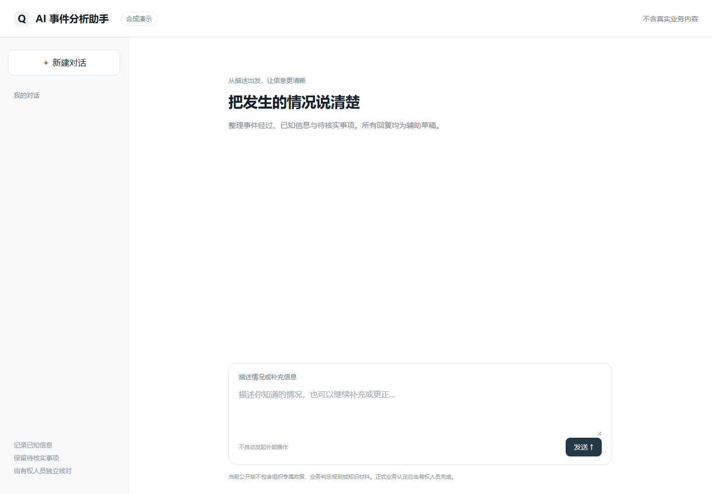
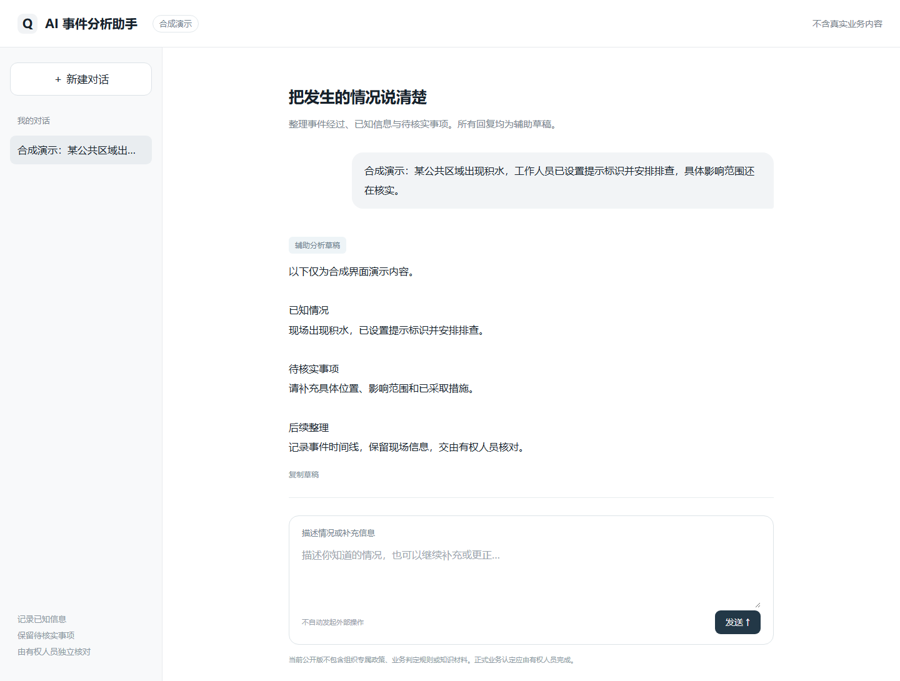
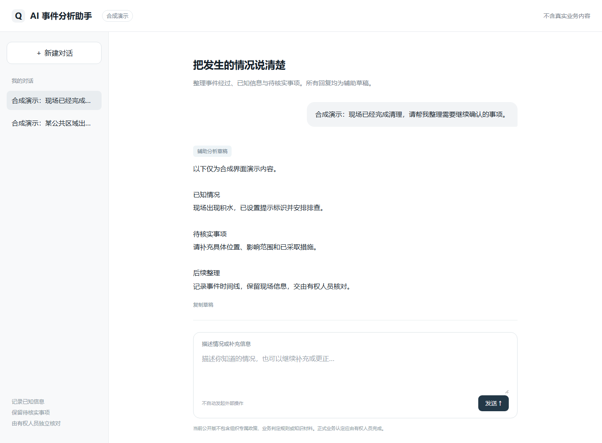
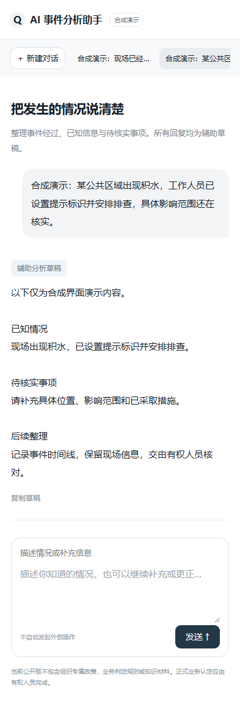

# AI 事件分析助手 · 通用公开版

一个可以本地运行的通用 AI 助手：输入描述、保存对话、查看辅助草稿，并在同一输入框补充信息。

本公开版独立实现通用前后端、会话存储和兼容 Chat Completions 格式的模型接口。不包含任何组织信息、内部制度及派生规则、业务判定字段与阈值、内部数据契约、评测实现或评测材料。知识与业务规则需要部署方自行实现并取得相应授权。它不能复现内部系统的判定能力。

## 本地运行

需要 Python 3.12 或更高版本，无第三方 Python 或 Node 依赖。

```powershell
# 使用你已获授权的模型服务配置；密钥只设置在服务端环境中。
$env:MODEL_API_URL = 'https://your-authorized-service.example/v1/chat/completions'
$env:MODEL_API_KEY = '<your-private-key>'
$env:MODEL_NAME = '<your-authorized-model>'
python server.py
```

打开 http://127.0.0.1:4312 。也可以先不配置模型，启动后查看界面；发送内容会保存，但明确提示模型未配置，不会伪造回答。

API Key 不发送给浏览器、不写入代码或数据库。`.env.example`只是配置说明，不会自动加载。不要在 Git 中提交真实配置。对话与本机会话密钥写入默认忽略的 `runtime/`。

## 功能与边界

- 新建、保存、恢复对话；内容按本机会话隔离。
- 服务端连接用户明确配置的模型服务，不自动重试收费请求。
- 用户原话和模型草稿分开保存；失败保留输入与状态。
- 网页按纯文本显示回答，避免执行模型返回的 HTML。
- 固定监听本机地址，检查写入来源与 CSRF；最多同时处理两次模型请求。

这是本地通用示例，没有组织账号、正式业务判定、制度检索或生产部署能力。共享电脑上的其他使用者仍可能访问本机文件；部署到网络前须另行实现认证、权限、运维和符合业务要求的审核。辅助草稿不能替代有权人员认定。

## 代码结构

```text
server.py       本机 HTTP API、SQLite 会话与模型连接
web/            无框架的网页交互与响应式样式
docs/screenshots/  合成界面截图
```

## 产品截图

截图来自本公开版的真实前端渲染，使用本机合成接口与合成描述，不连接真实模型，不包含真实业务或制度内容。它们仅展示界面和交互，不构成模型效果证据。

### 工作台



### 对话与辅助草稿



### 历史对话



### 手机端


